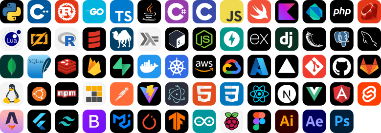

# Software Engineer

I'm a **17-year-old software engineer** building reliable applications, backend services, systems software, and AI infrastructure. I also work in **project management and product analysis**, connecting user needs with technical decisions and delivery priorities.

## Core Skills

  

- **Languages:** Python · C++ · Rust · Go · TypeScript · SQL · C# · Java · C · JavaScript · Objective-C · PHP · Ruby · Swift · Kotlin · Dart · Lua · Zig · R · Scala · Perl · Haskell · Bash · Assembly · MATLAB
- **Software Engineering:** Data Structures & Algorithms · Software Architecture · API Design · Database Design · Automated Testing · Debugging · Performance Optimization · Maintainable Code
- **Backend & APIs:** Node.js · FastAPI · Express · Django · Flask · Spring Boot · discord.js · REST APIs · GraphQL · gRPC · RPC · RabbitMQ
- **Databases & Data:** PostgreSQL · MySQL · MongoDB · SQLite · Redis · Firebase · Cassandra · Elasticsearch · Supabase
- **DevOps & Cloud:** Docker · Kubernetes · AWS · GCP · Azure · Nginx · Apache · GitHub Actions · Jenkins · Vercel
- **Tools & Platforms:** Git · GitHub · GitLab · Linux · Ubuntu · npm · pnpm · Postman · Vite · Webpack · Electron · Termux · PM2 · Apple Silicon / Metal
- **Security & Research:** Critical Infrastructure Security · ICS/SCADA · Social Engineering · Human Behavior · Security Decision-Making
- **ML & AI Systems:** PyTorch · TensorFlow · Keras · Scikit-learn · ONNX · CUDA · TensorRT · OpenCV · pybind11 · MLX · LangChain · Hugging Face · Continuous Batching · Autograd
- **Frontend & Mobile:** HTML5 · CSS3 · React · Next.js · Vue.js · Angular · Svelte · Astro · Flutter · React Native · Tailwind CSS · Bootstrap · Material UI
- **Hardware & IoT:** Arduino · ESP32 · Raspberry Pi
- **Design & Multimedia:** Figma · Adobe Photoshop · Illustrator · After Effects
- **Product & Delivery:** Requirements Definition · Prioritization · Delivery Planning · Work Coordination · Risk Management · Product Metrics · Hypothesis Testing · User Behavior Analysis
- **Leadership & Collaboration:** Clear Communication · Accountability · Initiative · Shared Goals · Critical Thinking · Adaptability · Constructive Feedback · Explaining Complex Ideas

## Infrastructure & Security Research

My infrastructure work includes **dedicated AI clusters, model pipelines, AI data center engineering, and high-throughput, fault-tolerant networks**. I'm interested in how software, hardware, and networking work together to support demanding workloads.

My cybersecurity research covers **critical infrastructure and ICS/SCADA environments**, including systems used in nuclear power plants. I also study **social engineering and human behavior** to understand security decisions and strengthen organizational defenses.

## Product & Delivery

- **Project management:** Define requirements, set priorities, coordinate work, and manage risks throughout delivery.
- **Product analysis:** Connect user needs and behavior with meaningful metrics and testable hypotheses to guide decisions.
- **Leadership:** Communicate clearly, take responsibility, encourage constructive feedback, and keep the team aligned on shared goals.

## Beyond Code

I play chess with a **2600 rating on Chess.com**. I value the strategic planning, pattern recognition, and disciplined decision-making the game demands.

## Links

  &nbsp;&nbsp;
  &nbsp;&nbsp;
  

## Activity

