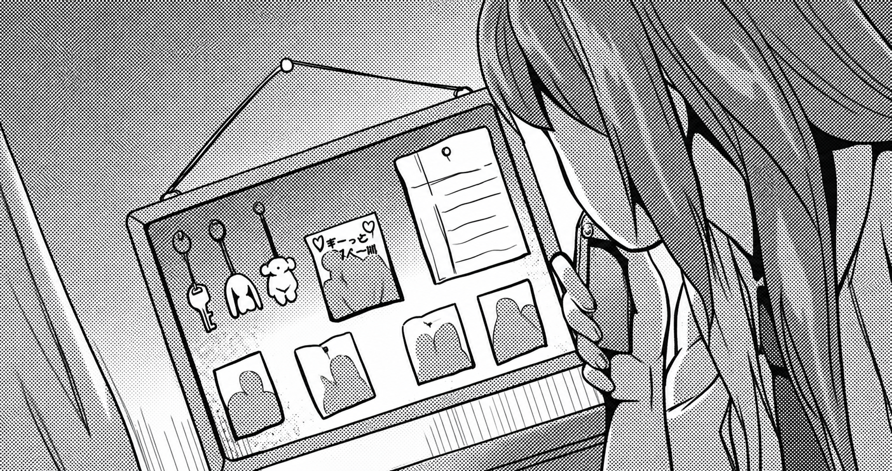

I'm **wxva, a 17-year-old developer**, passionate about building modern web applications and continuously improving my software engineering skills.

I mainly work with **JavaScript, TypeScript, React, Next.js and Tailwind CSS**, while expanding my knowledge into backend development, databases, APIs, architecture and scalable applications.

I'm currently focused on building projects that go beyond basic implementations and allow me to explore real-world software engineering concepts.

## 🛠️ Tech Stack

  

- **Languages:** JavaScript · TypeScript · Python
- **Frontend & Mobile:** HTML5 · CSS3 · React · Next.js · Astro · Flutter · React Native · Tailwind CSS · Bootstrap · Material UI
- **Backend & Cloud:** Node.js · Supabase
- **Databases:** PostgreSQL · MongoDB · SQLite
- **DevOps & Tools:** Git · Docker · Vite · npm · pnpm · Postman · Vercel
- **Design & Multimedia:** Figma · Adobe Photoshop · Illustrator · After Effects
- **Hardware & IoT:** Arduino

---

## 🌐 Let's connect

###

 

###
