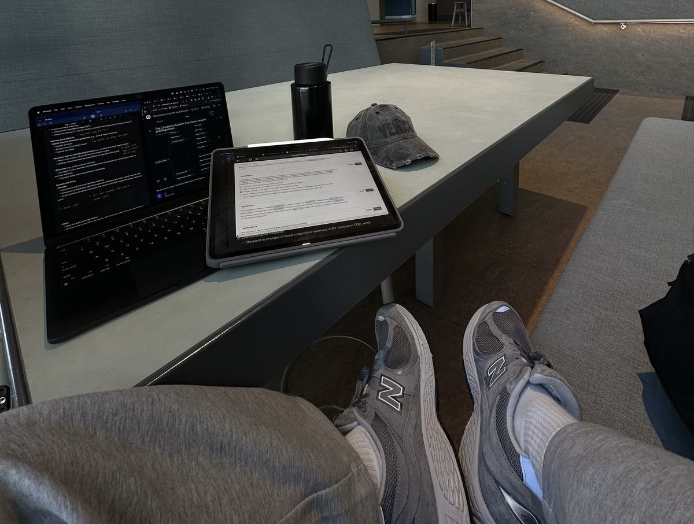

I'm a **17-year-old software engineer** focused on designing, building, and maintaining reliable software, with an emphasis on backend services, systems programming, and developer tools.

My technical focus is **Python, C++, Rust, Go, TypeScript, and SQL**, alongside **Linux, Git, Docker, PostgreSQL, and Redis**. I use these technologies to build services, APIs, and system tools, while deepening my understanding of memory management, concurrency, networking, and communication between services.

My work also spans **AI infrastructure, systems and network architecture, data center engineering, and cybersecurity research**. This includes dedicated AI clusters, model pipelines, and fault-tolerant networks, along with research into critical infrastructure security and ICS/SCADA systems used in nuclear power plants.

Through practical projects, I'm strengthening my skills in **data structures and algorithms, software architecture, API design, automated testing, debugging, and performance optimization**. My goal is to turn complex requirements into clear designs, maintainable code, and systems that balance reliability, scalability, and security.

## Core Skills

  

- **Languages:** Python · C++ · Rust · Go · TypeScript · SQL · C# · Java · C · JavaScript · Objective-C · PHP · Ruby · Swift · Kotlin · Dart · Lua · Zig · R · Scala · Perl · Haskell · Bash · Assembly · MATLAB
- **Backend & APIs:** Node.js · FastAPI · Express · Django · Flask · Spring Boot · discord.js · REST APIs · GraphQL · gRPC · RPC · RabbitMQ
- **Databases & Data:** PostgreSQL · MySQL · MongoDB · SQLite · Redis · Firebase · Cassandra · Elasticsearch · Supabase
- **DevOps & Cloud:** Docker · Kubernetes · AWS · GCP · Azure · Nginx · Apache · GitHub Actions · Jenkins · Vercel
- **Tools & Platforms:** Git · GitHub · GitLab · Linux · Ubuntu · npm · pnpm · Postman · Vite · Webpack · Electron · Termux · PM2 · Apple Silicon / Metal
- **ML & AI Systems:** PyTorch · TensorFlow · Keras · Scikit-learn · ONNX · CUDA · TensorRT · OpenCV · pybind11 · MLX · LangChain · Hugging Face · Continuous Batching · Autograd
- **Frontend & Mobile:** HTML5 · CSS3 · React · Next.js · Vue.js · Angular · Svelte · Astro · Flutter · React Native · Tailwind CSS · Bootstrap · Material UI
- **Hardware & IoT:** Arduino · ESP32 · Raspberry Pi
- **Design & Multimedia:** Figma · Adobe Photoshop · Illustrator · After Effects

---

## 🌐 Let's connect

###

 

###
